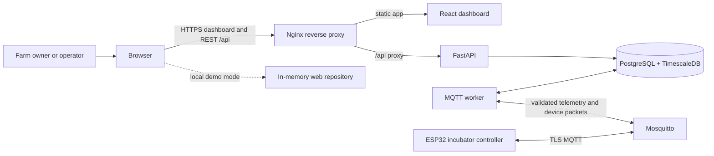

# EGGCELERATE system architecture preparation

**Status:** Working architecture brief, prepared 2026-10-18  
**Purpose:** Establish the verified current system, target boundaries, deployment views, and unresolved decisions for the canonical system architecture.  
**Scope:** Web dashboard, API, persistence, MQTT, ESP32 firmware, and deployment. Native mobile is outside the current system.

This brief separates code that exists from deployment and hardware acceptance that remain unconfirmed. It is a preparation artifact; it does not claim production or physical qualification.

## System purpose and design rules

EGGCELERATE lets a farm owner manage incubators and incubation cycles, observe device telemetry, and request supported lifecycle or tray operations. The ESP32 owns the fast climate-control and equipment-safety loop. The server stores farm state, reports device state, and sends bounded, expiring requests; it is not the thermal controller.

Architecture rules to preserve:

- In container deployments, the browser uses the same-origin `/api` proxy over HTTP(S). Local Vite API mode can use a configured API URL. The browser never connects to MQTT.
- REST carries dashboard reads and owner actions. MQTT carries device telemetry and device-directed packets. There is no WebSocket path.
- Farm scope comes from the authenticated API session and server-side device registry, not from a tenant ID trusted in a device payload.
- Persist command intent before dispatch. Expiry, ordering, idempotency, and device-side replay checks protect retries and delayed delivery.
- A cloud or network failure must not disable local sensing or the device's safety behavior. A missing device report cannot be treated as proof that an output is off.

## System context

The physical and cloud sides have separate responsibilities. The ESP32 samples sensors and controls local outputs. The API and database provide farm-scoped configuration, history, dashboards, and durable command state. The MQTT worker bridges the database and broker. In mock mode, the browser uses the in-memory repository and does not need the API.

## Runtime components

| Component | Responsibility | Current implementation |
|---|---|---|
| Web client | Screens, navigation, domain calculations, forms, and query/mutation state | React 19, TypeScript, Vite, Wouter, TanStack Query; injected in-memory or HTTP repository |
| Nginx edge | Serve the built single-page app and proxy `/api` to the API | Web container in Compose; HTTPS edge is configured as a deployment overlay |
| FastAPI | Versioned REST routes, validation, authentication, farm authorization, use cases, readiness | Python/FastAPI/Pydantic; session-based authorization for API mode |
| Storage | Durable farm configuration and journals, accounts/sessions, telemetry, device projections, command state | PostgreSQL with TimescaleDB extension and explicit Alembic migrations; memory adapter remains for demo/local use |
| MQTT worker | Validate device messages, resolve provisioned device IDs, persist telemetry, reconcile and publish eligible packets | Separate Python process sharing the API code and database; simulator and hardware configurations have different security settings |
| MQTT broker | Device transport | Mosquitto; a loopback simulator broker is separate from the TLS hardware broker configuration |
| ESP32 | Sensor sampling, local climate control, output safety, displays, Wi-Fi setup, and timed tray task | NodeMCU-32S firmware in `apps/firmware/Eggcelerate`; NVS stores local identity and run/control safeguards |
| Mobile/shared packages | Future native client or genuinely shared code | Reserved; no native mobile app or shared package consumer exists today |

### Web and API boundary

The dashboard selects an `EggcelerateRepository` implementation at startup. Mock mode uses fixture-backed memory data. API mode uses `ApiRepository`, validates transport envelopes, and sends requests through the same-origin `/api` proxy. TanStack Query owns cached server-like state; route state is owned by Wouter. Dashboard freshness is obtained by polling REST endpoints; it is not pushed over WebSockets.

The API separates HTTP routes, Pydantic DTOs, use cases, storage access, and PostgreSQL persistence. In API mode, the server derives farm membership from an opaque session cookie; writes also require the session CSRF token. Operator tooling creates pilot owners, resets passwords, and reserves device IDs for farms.

### Device and MQTT boundary

The hardware firmware publishes current readings and a climate/tray runtime report over TLS MQTT. The worker validates the topic and payload, resolves the registered device to its farm, persists raw telemetry and the latest device projection, then publishes a receipt only after the database transaction commits. The dashboard reads those persisted projections through the API.

For enabled hardware control, owner actions are persisted by the API. The hardware worker reads eligible intent and publishes ordered, expiring packets on the device's receipt topic. The ESP32 validates the packet and runs the request through its independent local control task. Subsequent telemetry reports accepted command identity and reported state. The simulator command path is separate and uses its own topic/ACK flow.

Firmware reports commanded output states; the installed system has no feedback sensor that proves a relay contact, fan airflow, or mist delivery physically changed state. Dashboard wording must keep that distinction visible.

## Important end-to-end flows

### Telemetry

1. The ESP32 samples temperature and humidity locally and publishes a fresh, sequenced reading over TLS MQTT.
2. The worker checks the registered device, assigned farm/chamber, payload contract, timestamps, and sequence.
3. A database transaction records the raw sample and updates the boot-aware latest-device projection.
4. After commit, the worker sends a receipt to the device. Failed or rejected samples do not refresh the dashboard's device freshness.
5. The browser polls REST, and the API returns the stored readings and freshness projection.

The current firmware retries a later fresh sample after a publish failure; an offline telemetry backlog is not part of the documented contract. Local climate control continues independently when networking is unavailable.

### Lifecycle and tray requests

1. The owner requests a supported action through the dashboard.
2. The API checks session/farm scope, current lifecycle and device report, and action constraints; it commits the new intent and durable request state.
3. The hardware worker publishes an eligible, ordered, expiring packet over MQTT.
4. Firmware checks identity, expiry, ordering, local phase, sensor/fault state, and persistent replay state before it accepts work.
5. The local control task applies the operation and reports state in subsequent telemetry. The API reconciles that report with the persisted request.

Stop and local fault handling remain device responsibilities. Server acceptance, MQTT delivery, and firmware-reported output state are distinct events; none alone proves physical actuator movement.

## Deployment views

| Profile | Configuration | Intended use and boundary |
|---|---|---|
| Browser mock | `pnpm dev:web` or web build with `VITE_DATA_SOURCE=mock` | UI development and demonstrations; browser-local state, no server durability or device connection |
| API development | Base `compose.yaml` | Web and FastAPI; API defaults to memory storage and disabled auth for local development |
| Durable API | Base Compose plus the `database` profile and production-shaped API settings | PostgreSQL/TimescaleDB with sessions and migrations; suitable for integration work when configured |
| Simulator | `compose.simulator.yaml` | Isolated loopback Mosquitto and simulator worker; dispatch is disabled unless explicitly enabled; not a physical-device broker |
| Hardware rehearsal | `compose.hardware.yaml` plus `compose.hardware-local.yaml` | TLS broker, device/worker credentials, ACLs, and local rehearsal endpoints; climate/tray flags are explicit configuration |
| VPS pilot | Production, HTTPS, and hardware overlays | HTTPS dashboard/API, PostgreSQL, sessions, TLS hardware broker, and worker. The pilot has delivered real sensor readings to the VPS dashboard; the newer local climate/tray integration and updated firmware upload are not yet confirmed on the VPS/device. |

Private environment files, broker credentials, TLS private keys, and firmware cloud configuration stay outside Git. Device credentials are embedded through private local firmware configuration; the public CA certificate is also included so TLS can verify the broker. Broker private keys stay on the server. Simulator broker settings and hardware broker settings must not be conflated.

## Trust, safety, and data ownership

| Concern | Authority and boundary |
|---|---|
| Account and farm access | API session and database membership; UI guards are presentation only |
| Device-to-farm routing | Operator-provisioned device registry plus broker credentials/ACLs; a short pairing code links setup to a farm but is not MQTT authentication |
| Farm and cycle records | PostgreSQL in durable/API deployment; browser cache is not authoritative |
| Raw readings and freshness | Server receipt time and persisted device projection; old, duplicate, invalid, or unassigned readings cannot make a device appear fresh |
| Power status | Current firmware's battery/grid fields are compatibility constants, not measured power-system telemetry |
| Climate safety | ESP32 local control task, sensor checks, watchdog/fault handling, and safe output policy; API/MQTT are supervisory paths |
| Command progress | Durable API request and device report are separate states; timeouts or missing reports remain uncertain, not successful |
| Physical output state | Firmware report is evidence of commanded state only; it is not relay, airflow, temperature-at-egg, or tray-position feedback |
| Secrets | Deployment secrets and device credentials in private ignored configuration; only public CA material belongs in firmware configuration |

## Current status and limits

- The web/API/PostgreSQL architecture and authenticated farm-scoped API are implemented in the repository.
- Local hardware firmware includes sensor/cloud reporting, automatic preparation/incubation climate logic, and integrated timed tray scheduling. The cloud-control path is feature-gated in deployment configuration.
- The October 18 roadmap records user-confirmed wiring and manual actuator operation, but the latest firmware upload and the full supervised control acceptance are not confirmed. New local control code is not evidence that the VPS is running it.
- Firmware's current `battery_pct` and `power_source` values are placeholders; they must not be presented or used as measured power status.
- Fan PWM integration/qualification, actuator fault feedback, backup restore qualification, and source-to-VPS release reconciliation remain open operational or hardware work.
- The VPS pilot is a constrained pilot, not a public-release readiness claim. Production signup remains closed; account recovery and broader team membership are not complete.

## Decisions needed before treating this as the final architecture

1. **Release source of truth:** define how a tested Git revision maps to local images and VPS deployment, including rollback and firmware version reporting.
2. **Operating targets:** record expected farms/devices, telemetry retention, dashboard freshness, availability, recovery time, and recovery-point expectations.
3. **Hardware acceptance boundary:** agree what evidence is required for climate, Stop, power recovery, tray schedule/home behavior, and physical outputs. Preserve the user's direction not to repeat already accepted motor timing observations.
4. **Telemetry resilience:** decide whether current-sample-only reporting is sufficient or whether devices need a durable offline queue and replay policy.
5. **Identity lifecycle:** define credential rotation, device replacement/transfer, and pairing-code rotation for future farms beyond the current installer-managed pilot.
6. **Product scope:** keep native mobile, public self-registration, email recovery, notifications delivery, and uploaded candling-photo storage out of this architecture until each is explicitly selected.

These decisions do not prevent publishing the current-state diagrams. They do affect a production target architecture and its qualification gates.

## Source map and reconciliation work

Current implementation should be checked against source under `apps/web`, `apps/api`, `apps/firmware`, Compose files, and the October 18 entry in `ROADMAP.md`. The current handoffs are [capstone next phases](../guide/capstone-next-phases-2026-10-15.md), [preparation flow](../guide/incubator-preparation-guide.md), [tray turning](../guide/tray-turning-guide.md), and [incubation-control improvement plan](../guide/incubation-control-improvement-plan-2026-10-18.md).

The older [system architecture guide](../SYSTEM_ARCHITECTURE_GUIDE.md), root README, API README, and some MQTT/auth guides predate the current ESP32 pilot and integrated hardware-control work. Reconcile their status claims against the source and current roadmap before using them as the final architecture authority. This brief intentionally leaves those existing files untouched.
